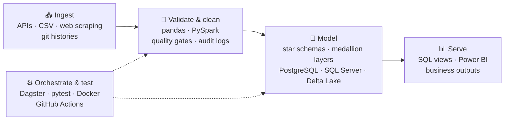

  

  
  
  
  

| 🚀 **6** | 📦 **200K+** | ✅ **10** | 🔗 **~99%** |
|:---:|:---:|:---:|:---:|
| end-to-end data projects | source records ingested and cleaned | automated quality checks gating one pipeline | of 13,587 PRs matched to git commits |

---

## 👋 About Me

I'm a **Data Engineer** with a strong analytics background, and I enjoy owning data from source to insight. I ingest data from APIs, files, websites and git histories, clean and validate it with **Python, SQL and PySpark**, model it in **PostgreSQL, SQL Server and Databricks Delta Lake**, and deliver it to **Power BI** dashboards and business stakeholders.

I build pipelines to be trusted: **keyed schemas, data-quality gates that stop a bad run, idempotent re-runnable builds, unit tests, containerised databases and clear documentation**. I've applied this across 🏥 **healthcare**, 📦 **supply chain and FMCG**, ⚙️ **software delivery**, 🛒 **retail** and 🛍️ **e-commerce**.

---

## 💼 What I Bring

<table>
<tr>
<td width="50%" valign="top">

**🔄 Data Pipeline Development** 
ETL/ELT design · batch processing · incremental loads · API and web data ingestion · idempotent, re-runnable jobs

**🧱 Data Modelling & Warehousing** 
Star and galaxy schemas · medallion (bronze/silver/gold) architecture · fact and dimension design · primary and foreign key integrity

**⚡ Big Data Processing** 
PySpark · Delta Lake · Databricks jobs · processing millions of rows

**✅ Data Quality & Governance** 
Validation rules and pipeline gates · data-quality logs · reconciliation checks · UK GDPR data minimisation · documented lineage

</td>
<td width="50%" valign="top">

**🛠️ Automation & DevOps for Data** 
Dagster orchestration · Docker · GitHub Actions CI/CD · pytest · pre-commit and linting · environment management

**📊 Analytics & BI** 
Power BI and DAX · KPI design · demand forecasting · statistical testing · SQL analysis

**🗣️ Stakeholder Communication** 
Executive summaries and presentations · translating data into business recommendations · clear technical documentation

**🤝 Ways of Working** 
Git branching and pull requests · version control · problem solving · teamwork · critical thinking

</td>
</tr>
</table>

---

## 🧰 Tech Stack

| | |
|---|---|
| **💻 Languages** |    |
| **🗄️ Platforms & databases** |         |
| **⚙️ Orchestration & DevOps** |        |
| **🔧 Data processing** |      |
| **📊 Analytics & ML** |      |
| **🌱 Currently learning** |     |

---

## 🏗️ How I Build Pipelines

---

## 🚀 Featured Projects

### ⚙️ [Engineering Delivery Intelligence](https://github.com/GLICON/engineering-delivery-intelligence)
`Python` `PostgreSQL` `SQL` `SQLAlchemy` `pytest` `statsmodels`

- Built a **5-stage ELT pipeline** that ingests **14,384** raw rows and **12** git histories, and models **13,587** merged pull requests from Kubernetes, Envoy, Helm, Prometheus and 8 other CNCF projects.
- Matched **~99%** of PRs to their merge commit and first release by parsing git tags, merge and squash commits, and reverts.
- Loaded a keyed PostgreSQL schema (**4** tables, PK/FK) gated by **10** data-quality checks that fail the run on any broken rule, with pytest unit tests.
- 💡 **Insight:** the median PR spends **2.6 days** in code review but **46.2 days** waiting to ship.

### 📦 [FMCG Planning Control Tower](https://github.com/GLICON/fmcg-planning-control-tower)
`SQL Server` `Docker` `T-SQL` `Python` `LightGBM` `Holt-Winters`

- Modelled real daily manufacturer data into SAP-style tables (MARA, MARC, VBAP, MSEG): **19,225** source records rolled up to **9,061** product-day rows covering **7.75M** units.
- Wrote a referential integrity check and an **idempotent fix** that took orphaned master data from **1** issue to **0**.
- Backtested **4** forecasting models. The blend reached **25.8%** weekly WAPE, and LightGBM had the lowest bias (**−1.1%**).
- Produced safety stock, fill rate, FIFO ageing and ABC/XYZ segmentation, exported as an **SAP-ready** safety-stock proposal.

### 🏥 [NHS Prescribing Savings Pipeline](https://github.com/GLICON/nhs-prescribing-savings) · *in active development*
`Databricks` `PySpark` `Delta Lake` `Dagster` `GitHub Actions`

- A monthly **medallion lakehouse** (bronze → silver → gold → stats) designed to process **~18M** NHS prescribing rows a month, with Delta `MERGE` incremental loads and Dagster orchestration.
- It estimates generic-switch savings by GP practice and ICB, and tests whether deprivation explains prescribing variation.

### 🚚 [DataCo Supply Chain Analysis](https://github.com/GLICON/dataco-supply-chain-analysis)
`pandas` `DuckDB` `Power BI` `DAX`

- Cleaned **180,519** order lines (**29** logged quality issues, PII removed for UK GDPR) into a galaxy schema with **70+** DAX measures, reconciled across pandas, SQL and Power BI.
- 💡 **Insight:** a **10%** discount cap is worth an estimated **+$1.14M** profit, and **$741K** of suspected fraud traced to one payment method.

### 🛒 [UrbanNest Retail Pipeline](https://github.com/GLICON/urbannest-retail-pipeline)
`pandas` `PostgreSQL` `SQLAlchemy` `SQL`

- Cleaned **5,000** messy multi-channel orders with **zero rows lost**, flagged **798** contradictory statuses instead of deleting them, and built a re-runnable star schema that reconciles to source revenue.

### 👓 [Eyewear Market Web Scraper](https://github.com/GLICON/eyewear-web-scraper)
`Selenium` `BeautifulSoup` `pandas` `SQLite`

- Scraped **568** products from **2** JavaScript-rendered retail sites, handling pagination quirks, advert tiles and bot checks politely, into a **21**-column SQLite dataset.

---

## 🔭 Currently Working On

- 🏥 Finishing the **NHS lakehouse** on Databricks: PySpark transforms, Delta `MERGE` incremental loads and CI on GitHub Actions.
- ☁️ A cloud **ELT project with Snowflake, dbt (with tests) and Airflow**, landing raw data in cloud storage first.

**📁 Earlier analytics projects:** [Nike Sales](https://github.com/GLICON/Nike-Running-Shoes-Sales-Performance) · [Advertising vs Sales](https://github.com/GLICON/Advertising_Sales_and_Budget) · [SF Intern Salaries](https://github.com/GLICON/San-Francisco-Intern-Salaries) · [Wine Quality](https://github.com/GLICON/Wine_Quality)

---

## 🤝 Let's Connect

I'm looking for **Data Engineer** and **Analytics Engineer** opportunities in the UK, and I'm always happy to chat about data. 
**LinkedIn:** [adebayo-atkinson](https://www.linkedin.com/in/adebayo-atkinson-583190134/) · **Email:** [ibayoatkinson@gmail.com](mailto:ibayoatkinson@gmail.com)

Off the clock: 🏀 basketball · ⚽ football · 🏋️ gym · ♟️ chess

